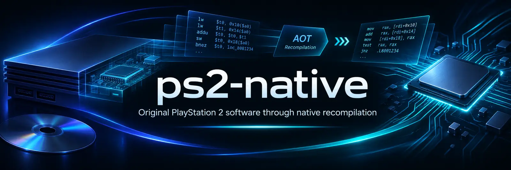

<div align="center">



# ps2-native

**An open research project for running original PlayStation 2 software through native ahead-of-time recompilation.**

[](https://github.com/fabegalo/ps2-native/actions/workflows/build.yml)
[](STATUS.md)
[](docs/LICENSE-DECISION.md)

[English](README.md) · [Português (Brasil)](README.pt-BR.md) · [Current status](STATUS.md) · [Documentation](docs/README.md) · [Contributing](CONTRIBUTING.md)

</div>

> **Experimental research software, not a playable PS2 launcher.** The project can analyze and recompile a verified subset of PS2 code and execute part of original firmware using an offline AOT/native runtime that explicitly refuses missing translations. It does **not** complete the original Browser boot or run commercial games. Passing CI does not prove gameplay or platform-level runtime compatibility.

## What is ps2-native?

The goal is to execute the **original PlayStation 2 BIOS/interface and games** on modern computers, following the x360-native model: original code translated statically (**AOT**) and system services implemented through **native HLE**. Executed EE/R5900, IOP/R3000A and VU0/VU1 instructions must be compiled for the host. GS, DMA, SPU2, controls, memory and timing remain necessary in the shared runtime.

Interpreters are restricted to validation binaries, outside production executables. Dynamic modules require offline AOT preparation; HLE may supply BIOS/kernel and IOP services without interpreting instructions. This does not authorize fabricated BIOS screens or omitted guest effects. This is the required execution policy, not a claim of complete implementation or validated gameplay.

The **original PlayStation 2 Browser** and system configuration screens are targets in their own right. The desktop management launcher provides **Import → Prepare → Play** through verified native modules, using the configured local toolchain. Missing translations and services stop explicitly; the launcher does not replace Sony's menus with imitations.

## Current status

| Subsystem | Demonstrated | Still missing |
|---|---|---|
| **Native AOT** | Validated ELF32/MIPS analysis, conservative control-flow discovery, generated C++ and synthetic end-to-end execution | Broad commercial-game translation and dynamic-code coverage |
| **Emotion Engine** | Partial R5900 semantics, memory/TLB, hardware boot and offline AOT/native execution | Full CPU behavior, precise timing and exceptions |
| **IOP and firmware** | Partial R3000A boot, hardware registers, external NVM support, SIF flags and VBLANK | Complete BIOS/Browser boot, full interrupts, SIF DMA and peripheral services |
| **Graphics** | GS/GIF control registers, timing and a limited GIF PATH3 packet path | Framebuffer rendering, full GS/VU/VIF and game graphics |
| **Games and user experience** | Desktop library, native-module preparation, developer tools and synthetic fixtures | Playable games, installers and public releases |

**The maintained, evidence-based record is [STATUS.md](STATUS.md).** It distinguishes real firmware runs, diagnostic assumptions, CI results and missing functionality. Milestone-specific findings remain in [technical reports](docs/README.md); they are not copied into this README after every change.

## How it works

1. Load and validate user-supplied firmware or a legally obtained MIPS executable. Keep each BIOS revision, region and its matching resources isolated.
2. Analyze provably reachable code and emit C++20 AOT blocks for instructions with supported semantics.
3. Execute prepared AOT artifacts with the necessary native HLE services. Missing code requires offline preparation and a precise diagnostic; interpreter fallback is not permitted in the product.
4. Improve hardware fidelity using technical evidence, reproducible synthetic tests and documented real-firmware observations. Unsupported operations must not silently succeed.

**Performance-first, correctness-preserving:** optimize the recompilation, CPU, memory and graphics paths without sacrificing console behavior. Any future enhanced rendering mode must preserve game logic, physics and synchronization.

## Build and test

Requirements: **CMake 3.21+**, a **C++20 compiler** and **Ninja** (or a supported native build generator). No mandatory external SDK or AVX instruction-set requirement.

```sh
cmake -S . -B out/build -G Ninja -DCMAKE_BUILD_TYPE=Release
cmake --build out/build --parallel
ctest --test-dir out/build --output-on-failure
```

On Windows, the Visual Studio CMake generator is also supported; pass `--config Release` when building and testing a multi-configuration build.

GitHub Actions builds and tests **Windows x86-64/ARM64, Linux x86-64/ARM64 (including the Steam Deck architecture) and macOS Intel/Apple Silicon**. Builds on all six targets are not evidence that real PS2 games work on those hosts.

### Developer tools

```sh
# Generate native C++ from a supported, legally obtained MIPS ELF.
./out/build/ps2n-aot input.elf out/build/generated/program.cpp

# Inspect a user-supplied ROM0 boot. Choose the matching console profile.
./out/build/ps2n-boot bios/your-rom0.bin --console=MODEL:MAINBOARD --trace=events

# If available, provide the NVM dumped from the matching console.
./out/build/ps2n-boot bios/your-rom0.bin --console=MODEL:MAINBOARD --nvm=bios/your-console.nvm --trace=events
```

`ps2n-aot` produces C++ that must be linked into a compatible host; it does not produce a standalone, playable game. `ps2n-boot` is a diagnostic runner and may stop on unsupported hardware. The current boot runner does not represent a successful BIOS startup merely because its process exits.

The user's original ROM0, ROM1/ROM2, NVM, games and generated proprietary translations are **not provided**. Keep them local and do not commit or redistribute them. A BIOS/NVM match must be verified, not inferred from filenames.

## Roadmap

The direction is **generic EE/IOP/VU AOT + native HLE services → original BIOS/Browser and games, with faithful GS/DMA/SPU2, controls and timing → cross-platform launcher and measured original speed**. BIOS and games are required targets; completing hardware boot is not a prerequisite for progress on a game path. This is a technical direction, not a release schedule or a compatibility promise. Follow [the next engineering task](docs/NEXT-TASK.md) for active work.

## Contributing and documentation

Contributions should include focused tests and evidence, keep a shared C++20 core across platforms and avoid per-game hacks, silent fallbacks and unnecessary file copies. See [CONTRIBUTING.md](CONTRIBUTING.md), [architecture](docs/ARCHITECTURE.md), [technical documentation](docs/README.md) and [project status](STATUS.md).

## License

Original ps2-native code retains **[BSD-3-Clause](LICENSE)**. The directly compiled [PS2Recomp HLE kernel](licenses/PS2Recomp/NOTICE) is **[GPL-3.0](licenses/PS2Recomp/LICENSE)**; combined binaries must comply with GPL-3.0, including corresponding source. PCSX2 remains a behavioral reference. Firmware, games, device-specific NVM and proprietary translated code are not included. See [licensing decisions](docs/LICENSE-DECISION.md).
