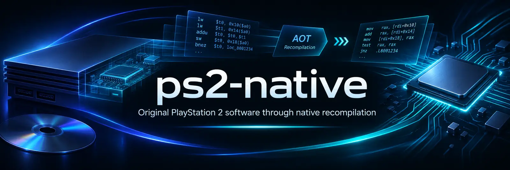

<div align="center">



# ps2-native

**Projeto aberto de pesquisa para executar software original do PlayStation 2 por recompilação nativa antecipada (AOT).**

[](https://github.com/fabegalo/ps2-native/actions/workflows/build.yml)
[](STATUS.md)
[](docs/LICENSE-DECISION.md)

[English](README.md) · [Português (Brasil)](README.pt-BR.md) · [Estado atual](STATUS.md) · [Documentação](docs/README.md) · [Como contribuir](CONTRIBUTING.md)

</div>

> **Software experimental de pesquisa, não um launcher de PS2 jogável.** O projeto analisa e recompila um subconjunto verificado de código do PS2 e executa parte do firmware original num runtime híbrido AOT/interpretador. Ainda **não** completa o boot do Browser original nem executa jogos comerciais. CI aprovada não comprova jogabilidade ou compatibilidade funcional em cada plataforma.

## O que é o ps2-native?

O objetivo é executar a **BIOS/interface e os jogos originais do PlayStation 2** em computadores modernos, seguindo o modelo do x360-native: código original traduzido estaticamente (**AOT**) e serviços de sistema implementados por **HLE nativo**. Instruções de EE/R5900, IOP/R3000A e VU0/VU1 que executarem devem estar compiladas para o host. GS, DMA, SPU2, controles, memória e temporização continuam necessários no runtime compartilhado.

Interpretadores são restritos a binários de validação, fora dos executáveis de produção. Módulos dinâmicos exigem preparação AOT offline; HLE pode fornecer serviços de BIOS/kernel e IOP sem interpretar instruções. Isso não autoriza recriar as telas da BIOS ou ignorar efeitos convidados. Esta é a política de execução exigida; não é uma afirmação de implementação completa ou gameplay validado.

O **Browser original do PlayStation 2** e as telas de configuração do sistema são alvos próprios. Um futuro launcher desktop gerenciará o conteúdo local do usuário; ele não substituirá os menus da Sony por imitações.

## Estado atual

| Subsistema | Demonstrado | Ainda falta |
|---|---|---|
| **AOT nativo** | Análise ELF32/MIPS validada, descoberta conservadora de fluxo, geração de C++ e testes sintéticos de ponta a ponta | Tradução abrangente de jogos comerciais e código dinâmico |
| **Emotion Engine** | Semântica parcial R5900, memória/TLB, boot de hardware e execução híbrida AOT/interpretador | CPU completa, temporização e exceções precisas |
| **IOP e firmware** | Boot parcial R3000A, registradores de hardware, NVM externa, flags SIF e VBLANK | Boot completo da BIOS/Browser, interrupções, DMA SIF e serviços restantes |
| **Gráficos** | Controle GS/GIF, temporização e um caminho limitado de pacotes GIF PATH3 | Renderização de framebuffer, GS/VU/VIF completos e gráficos de jogos |
| **Jogos e experiência** | Ferramentas técnicas e fixtures sintéticos | Jogos jogáveis, launcher, instaladores e Releases públicas |

**O registro atualizado e baseado em evidências fica em [STATUS.md](STATUS.md).** Ele separa execuções de firmware real, hipóteses de diagnóstico, resultados da CI e funcionalidades ausentes. Os detalhes de cada marco ficam nos [relatórios técnicos](docs/README.md), sem serem copiados para este README a cada mudança.

## Como funciona

1. Carregar e validar firmware fornecido pelo usuário ou um executável MIPS obtido legalmente. Isolar cada revisão/região de BIOS e seus recursos correspondentes.
2. Analisar código comprovadamente alcançável e gerar blocos AOT em C++20 somente com semântica suportada.
3. Executar os artefatos AOT preparados com os serviços HLE nativos necessários. Código ausente exige preparação offline e diagnóstico preciso; não há fallback interpretado permitido no produto.
4. Melhorar a fidelidade ao hardware com evidências técnicas, testes sintéticos reproduzíveis e observações documentadas de execuções de firmware real. Operações não implementadas nunca devem retornar sucesso silencioso.

**Performance-first, correctness-preserving:** otimizar recompilador, CPU, memória e gráficos preservando o comportamento do console. Um futuro modo gráfico aprimorado deverá preservar lógica, física e sincronização dos jogos.

## Compilar e testar

Requisitos: **CMake 3.21+**, **compilador C++20** e **Ninja** (ou gerador nativo compatível). Não há SDK externo obrigatório nem exigência de instruções AVX.

```sh
cmake -S . -B out/build -G Ninja -DCMAKE_BUILD_TYPE=Release
cmake --build out/build --parallel
ctest --test-dir out/build --output-on-failure
```

No Windows, também é possível usar o gerador Visual Studio do CMake; em builds com várias configurações, usar `--config Release` para compilar e testar.

O GitHub Actions compila e testa **Windows x86-64/ARM64, Linux x86-64/ARM64 (incluindo a arquitetura do Steam Deck) e macOS Intel/Apple Silicon**. Compilar nos seis alvos não comprova que os jogos de PS2 funcionam neles.

### Ferramentas de desenvolvimento

```sh
# Gerar C++ nativo a partir de um ELF MIPS suportado e obtido legalmente.
./out/build/ps2n-aot entrada.elf out/build/generated/programa.cpp

# Diagnosticar o boot de uma ROM0 fornecida pelo usuário.
./out/build/ps2n-boot bios/sua-rom0.bin --console=MODELO:PLACA --trace=events

# Caso exista, fornecer a NVM extraída do mesmo console.
./out/build/ps2n-boot bios/sua-rom0.bin --console=MODELO:PLACA --nvm=bios/sua-nvm.nvm --trace=events
```

`ps2n-aot` gera C++ que precisa ser ligado a um host compatível; não produz sozinho um jogo executável. `ps2n-boot` é uma ferramenta de diagnóstico e pode parar em hardware não implementado. O encerramento do processo não deve ser confundido com uma BIOS inicializada com sucesso.

ROM0, ROM1/ROM2, NVM, jogos e traduções proprietárias geradas **não são fornecidos**. Mantenha esses arquivos localmente e não os publique no repositório. A correspondência BIOS/NVM deve ser validada, não presumida pelo nome.

## Roadmap

A direção é **AOT genérico de EE/IOP/VU + serviços HLE nativos → BIOS/Browser original e jogos, com GS/DMA/SPU2, controles e temporização fiéis → launcher multiplataforma e velocidade original medida**. BIOS e jogos são alvos obrigatórios; concluir o boot de hardware não é pré-requisito para avançar no caminho de um jogo. Isso não é uma promessa de compatibilidade nem um cronograma de lançamento. Acompanhe a [próxima tarefa de engenharia](docs/NEXT-TASK.md) para o trabalho ativo.

## Contribuição e documentação

Contribuições devem incluir testes focados e evidências, manter um núcleo único em C++20 para todas as plataformas e evitar hacks por jogo, fallbacks silenciosos e cópias desnecessárias. Consulte [CONTRIBUTING.md](CONTRIBUTING.md), [arquitetura](docs/ARCHITECTURE.md), [documentação técnica](docs/README.md) e [status](STATUS.md).

## Licença

O código original conserva **[BSD-3-Clause](LICENSE)**. O [kernel HLE adaptado do PS2Recomp](third_party/ps2recomp/NOTICE) usa **[GPL-3.0](third_party/ps2recomp/LICENSE)**; binários combinados devem cumprir a GPL-3.0, incluindo o código-fonte correspondente. PCSX2 continua como referência de comportamento. Firmware, jogos, NVM específica de aparelho e traduções proprietárias não estão incluídos. Veja as [decisões de licenciamento](docs/LICENSE-DECISION.md).
